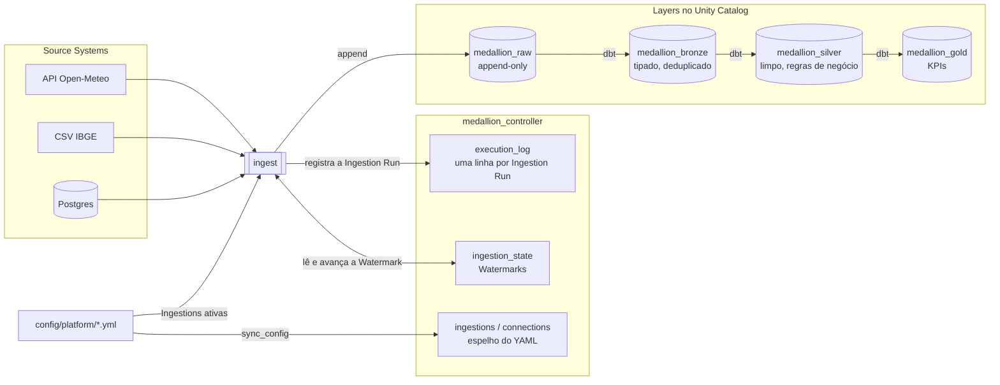
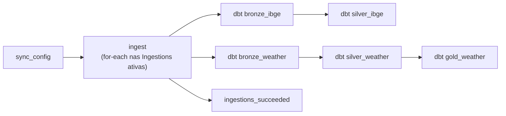

# Medallion Platform

Plataforma de dados **orientada a metadados** no Databricks. Para trazer um dado novo, você
**declara** a fonte num arquivo YAML: a plataforma cria a estrutura no Unity Catalog, ingere o dado
como chegou numa camada **raw** imutável e o refina com dbt através de **bronze → silver → gold**.
Nenhum código novo é necessário para uma fonte de API, CSV ou banco relacional.

Hoje ela roda todo dia às 06:00 (America/Sao_Paulo) com três Source Systems: clima horário de São
Paulo (API Open-Meteo), municípios do IBGE (CSV) e pedidos de um Postgres (JDBC, inativo; veja
[Conexões](docs/connections.md)).

## Destaques técnicos

- **Config como fonte da verdade.** Catálogos, schemas, volumes e permissões do Unity Catalog são
  declarados em [`catalog_structure.yml`](config/platform/catalog_structure.yml) e reconciliados a
  cada deploy, inclusive revogando permissões dadas à mão ([ADR 0004](docs/adr/0004-catalog-structure-reconciles-grants.md)).
- **Ingestão incremental com Watermark.** Cada Ingestion lembra até onde já leu (maior valor da
  coluna incremental ou impressão digital do arquivo) e a próxima Run lê só o que é novo. APIs com
  dado atrasado usam uma janela com `lag_days`.
- **Raw imutável.** Toda carga é apenas acrescentada e carimbada com a Run que a produziu;
  reprocessar gera duplicatas na raw de propósito, e a bronze deduplica com MERGE incremental. Assim
  qualquer camada pode ser reconstruída a partir da raw ([ADR 0002](docs/adr/0002-raw-is-append-only.md)).
- **Config e estado separados.** O espelho do YAML é sobrescrito a cada sync; o estado aprendido
  (Watermark, última Run) vive numa tabela à parte, escrita só pelo runtime
  ([ADR 0003](docs/adr/0003-ingestion-config-and-state-are-separate.md)).
- **Arquitetura hexagonal com limites verificados.** Regras de negócio ficam em `controller` e
  `ingestion`, que não conhecem Spark; só `medallion.databricks` importa pyspark, databricks-sdk ou
  dbutils. O CI falha se alguém quebrar essa regra ([ADR 0005](docs/adr/0005-controller-and-medallion-are-separate-modules.md)).
- **Testes sem cluster.** 129 testes rodam em ~2 s, sem Spark nem JVM, usando fakes das portas em
  [`tests/fakes/`](tests/fakes/).
- **Deploy versionado com o código.** Job e pacote Python são publicados juntos como Databricks
  Asset Bundle ([ADR 0001](docs/adr/0001-databricks-asset-bundles.md)); segredos ficam em secret
  scopes e nunca no Git.

## Arquitetura



A plataforma tem duas partes ([ADR 0005](docs/adr/0005-controller-and-medallion-are-separate-modules.md)):

- **Controller** declara, configura e registra: config, Catalog Structure, Ingestion State e o log
  de execução, no catálogo `medallion_controller`. Não guarda dado de negócio.
- **Medallion** move e refina o dado: as Ingestions para a raw e, depois, os projetos dbt.

O vocabulário (Source System, Ingestion, Watermark, Run, Layer…) está definido em
[`CONTEXT.md`](CONTEXT.md).

## Como roda

Um único job, definido em [`databricks.yml`](databricks.yml) e publicado como Asset Bundle com o
pacote `medallion`, roda todo dia às 06:00:



<!-- Prints do workspace (adicionar em docs/img/):


-->

O merge na `main` aplica a Catalog Structure, garante os secret scopes, envia os arquivos de origem
para o Volume e publica o bundle. Ele **nunca** dispara uma Run.

## CI/CD

| Quando | O que roda |
|---|---|
| Pull request para `main` ([`ci.yml`](.github/workflows/ci.yml)) | ruff (incluindo os limites de import), pytest, build do pacote, validação do config, `dbt parse` de cada projeto, validação do bundle e dry-run da Catalog Structure contra o workspace |
| Merge na `main` ([`deploy.yml`](.github/workflows/deploy.yml)) | aplica a Catalog Structure, cria secret scopes, envia CSVs ao Volume e faz `databricks bundle deploy` |

## Adicionando uma fonte

1. Declare o Source System em [`config/platform/catalog_structure.yml`](config/platform/catalog_structure.yml)
   (ele vira um schema em cada Layer).
2. Adicione as Ingestions em `config/platform/ingestions/<source_system>.yml`; cada uma cai em
   `medallion_raw.<source_system>.<raw_table>`.
3. Para bancos de dados, declare uma Connection e coloque a senha à mão: veja
   [`docs/connections.md`](docs/connections.md).
4. Crie os projetos dbt `dbt/bronze_<system>`, `dbt/silver_<system>`… e as tarefas deles em
   `databricks.yml`.

## Desenvolvimento

```bash
make install    # ambiente de desenvolvimento
make lint       # ruff, incluindo os limites de import
make test       # pytest, sem cluster Spark
make validate   # config + definição do bundle
make plan       # diff da Catalog Structure contra o workspace (dry-run)
make deploy     # apply + bundle deploy a partir da sua máquina (o CI faz isso no merge)
```

`validate`, `plan` e `deploy` leem `DATABRICKS_HOST` / `DATABRICKS_TOKEN` do `.env`
(veja [`.env.example`](.env.example)).
