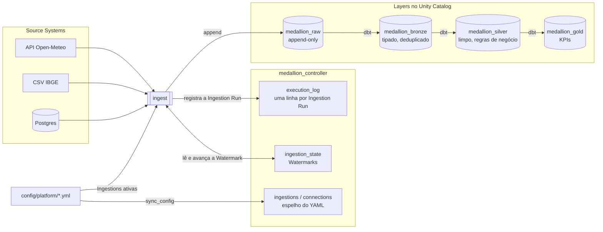
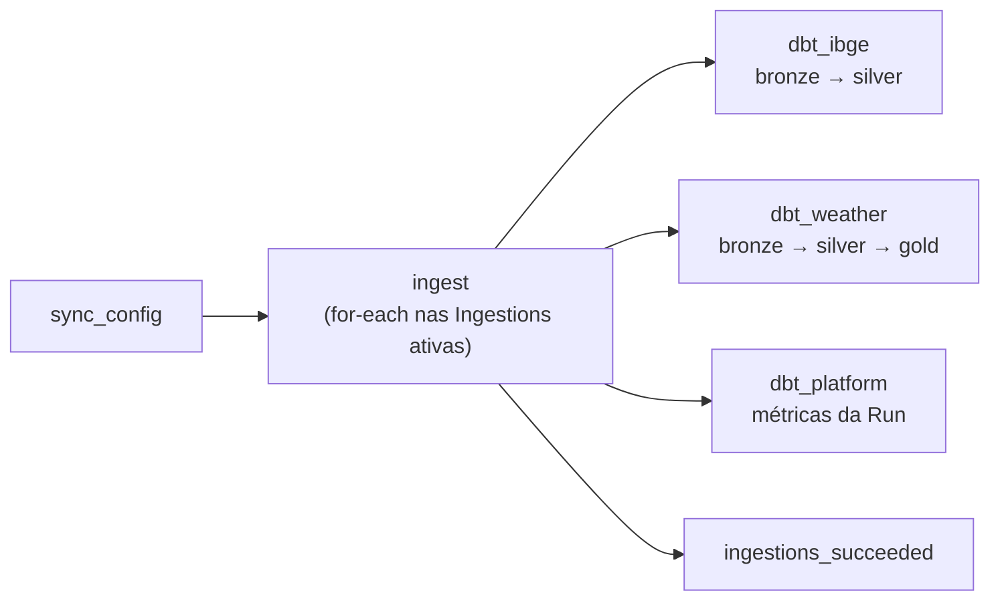
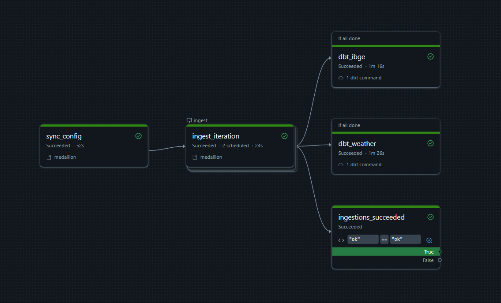
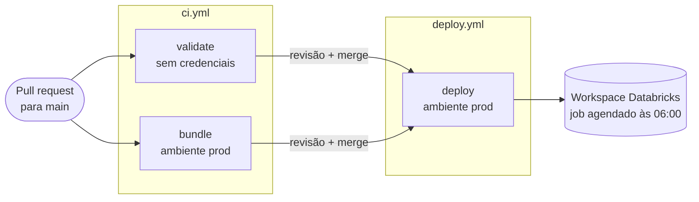

# Medallion Platform

Plataforma de dados **orientada a metadados** no Databricks. Para trazer um dado novo, você
**declara** a fonte num arquivo YAML: a plataforma cria a estrutura no Unity Catalog, ingere o dado
como chegou numa camada **raw** imutável e o refina com dbt através de **bronze → silver → gold**.
Nenhum código novo é necessário para uma fonte de API, CSV ou banco relacional.

Hoje ela roda todo dia às 06:00 (America/Sao_Paulo) com três Source Systems: clima horário de São
Paulo (API Open-Meteo), municípios do IBGE (CSV) e pedidos de um Postgres (JDBC, inativo; veja
[Conexões](docs/connections.md)).

## Destaques técnicos

- **Config como fonte da verdade.** Catálogos, schemas, volumes e permissões do Unity Catalog são
  declarados em [`catalog_structure.yml`](config/platform/catalog_structure.yml) e reconciliados a
  cada deploy, inclusive revogando permissões dadas à mão ([ADR 0004](docs/adr/0004-catalog-structure-reconciles-grants.md)).
- **Ingestão incremental com Watermark.** Cada Ingestion lembra até onde já leu (maior valor da
  coluna incremental ou impressão digital do arquivo) e a próxima Run lê só o que é novo. APIs com
  dado atrasado usam uma janela com `lag_days`.
- **Raw imutável.** Toda carga é apenas acrescentada e carimbada com a Run que a produziu;
  reprocessar gera duplicatas na raw de propósito, e a bronze deduplica com MERGE incremental. Assim
  qualquer camada pode ser reconstruída a partir da raw ([ADR 0002](docs/adr/0002-raw-is-append-only.md)).
- **Uma linhagem só, da raw à gold.** Todas as Layers vivem num único projeto dbt ligado por
  `ref()`, e o job roda uma tarefa por Source System gerada a partir do config
  ([ADR 0006](docs/adr/0006-one-dbt-project-tagged-by-source-system.md)).
- **Config e estado separados.** O espelho do YAML é sobrescrito a cada sync; o estado aprendido
  (Watermark, última Run) vive numa tabela à parte, escrita só pelo runtime
  ([ADR 0003](docs/adr/0003-ingestion-config-and-state-are-separate.md)).
- **Arquitetura hexagonal com limites verificados.** Regras de negócio ficam em `controller` e
  `ingestion`, que não conhecem Spark; só `medallion.databricks` importa pyspark, databricks-sdk ou
  dbutils. O CI falha se alguém quebrar essa regra ([ADR 0005](docs/adr/0005-controller-and-medallion-are-separate-modules.md)).
- **Testes sem cluster.** 148 testes de Python rodam em ~2 s, sem Spark nem JVM, usando fakes das
  portas em [`tests/fakes/`](tests/fakes/).
- **Qualidade de dados verificada a cada Run.** 34 testes dbt (chaves, nulos, faixas físicas e
  geográficas), um contrato de tipos na gold e um alarme de freshness na raw. Veja
  [Qualidade de dados](#qualidade-de-dados) e a [documentação dbt publicada](https://welbert-soares.github.io/medallion-platform/).
- **Observabilidade de fora para dentro.** As Runs viram métricas num modelo dbt, publicadas
  diariamente num [`metrics.json`](https://welbert-soares.github.io/medallion-platform/metrics.json),
  e um heartbeat no GitHub Actions avisa quando o job deixa de rodar. Veja [Observabilidade](#observabilidade).
- **CI/CD de ponta a ponta no GitHub Actions.** Todo PR é validado em duas frentes: código, config e
  dbt sem credenciais, e o diff que seria aplicado no workspace real. Só o merge publica, como
  Databricks Asset Bundle versionado junto com o código ([ADR 0001](docs/adr/0001-databricks-asset-bundles.md)).
  Detalhes em [CI/CD com GitHub Actions](#cicd-com-github-actions).

## Arquitetura



A plataforma tem duas partes ([ADR 0005](docs/adr/0005-controller-and-medallion-are-separate-modules.md)):

- **Controller** declara, configura e registra: config, Catalog Structure, Ingestion State e o log
  de execução, no catálogo `medallion_controller`. Não guarda dado de negócio.
- **Medallion** move e refina o dado: as Ingestions para a raw e, depois, o projeto dbt.

O vocabulário (Source System, Ingestion, Watermark, Run, Layer…) está definido em
[`CONTEXT.md`](CONTEXT.md).

## Como roda

Um único job, definido em [`databricks.yml`](databricks.yml) e publicado como Asset Bundle com o
pacote `medallion`, roda todo dia às 06:00:



Cada tarefa dbt roda `dbt build --select tag:<source_system>` sobre um único projeto dbt
([ADR 0006](docs/adr/0006-one-dbt-project-tagged-by-source-system.md)): as Layers daquele Source
System em ordem, com os testes no meio. Um teste que falha na silver impede a gold da mesma fonte,
e uma fonte com problema nunca bloqueia outra. As tarefas são geradas a partir do config por
`make bundle`.

Uma Run real no workspace: as duas Ingestions ativas rodam em paralelo no `ingest` (for-each), e
depois uma tarefa dbt por Source System, também em paralelo, leva cada fonte até a gold.



<!-- Print a adicionar em docs/img/:

-->

O merge na `main` aplica a Catalog Structure, garante os secret scopes, envia os arquivos de origem
para o Volume e publica o bundle. Ele **nunca** dispara uma Run.

## Qualidade de dados

Cada tarefa dbt roda `dbt deps`, `dbt build` (modelos e testes intercalados, na ordem do grafo) e,
quando a fonte declara, `dbt source freshness`. Qualquer falha derruba a tarefa daquele Source System
e, com ela, a Run.

| Pergunta | Como é verificada |
|---|---|
| O dado chegou? | **Freshness** na raw do clima: aviso com 30 h sem carga nova, erro com 2 dias. O IBGE não tem, porque é um CSV estático que só é recarregado quando o arquivo muda. |
| O valor é plausível? | **`accepted_range`** (dbt_utils): temperatura entre -10 e 50 °C, precipitação ≥ 0, coordenadas dentro do território brasileiro, código IBGE com 7 dígitos; **`accepted_values`** para as 27 UFs. |
| A tabela é íntegra? | **`unique` + `not_null`** na chave de toda tabela de bronze, silver e gold, e `not_null` nas medidas. |
| Quem consome pode confiar no formato? | **Contrato** (`contract: enforced`) na gold: nome, tipo e `NOT NULL` de cada coluna. Se o SQL mudar o formato, o build falha antes de gravar. |

Um teste que falha na silver impede a gold da mesma fonte, porque o `dbt build` só segue no grafo
depois dos testes do nó anterior.

### Documentação e linhagem

A cada deploy e todo dia depois da Run, o `dbt docs` é gerado contra o warehouse (com os tipos reais
das colunas) e publicado no GitHub Pages: **[https://welbert-soares.github.io/medallion-platform/](https://welbert-soares.github.io/medallion-platform/)**. Lá estão a
linhagem de cada tabela da raw até a gold, as colunas, as descrições e os testes.

## Observabilidade

A plataforma mede a si mesma com as próprias ferramentas
([ADR 0007](docs/adr/0007-platform-metrics-and-external-heartbeat.md)):

- **`medallion_gold.platform.run_metrics`:** um modelo dbt sobre o `execution_log` do Controller,
  com uma linha por Run (Ingestions executadas, com sucesso, puladas e com falha, linhas escritas,
  duração). A tarefa `dbt_platform` o reconstrói depois de toda ingestão, inclusive das que falham.
- **[`metrics.json`](https://welbert-soares.github.io/medallion-platform/metrics.json):** publicado no GitHub Pages pelo workflow
  [`site.yml`](.github/workflows/site.yml), todo dia às 06:30, com o formato da plataforma (fontes,
  Ingestions ativas, modelos e testes dbt) e o histórico das Runs. É de onde o portfólio lê os números.
- **Heartbeat externo:** os testes e a freshness rodam dentro do job, então não percebem o job **não
  rodar**. O mesmo workflow falha quando não houve Run nas últimas 26 horas, e o GitHub avisa por
  e-mail. Foi assim que apareceu um buraco real: de 08/10 a 02/11, o agendamento não disparou nenhuma
  Run.

## CI/CD com GitHub Actions

Nada chega ao workspace sem passar pelo GitHub Actions. Um pull request só mostra o que **mudaria**; o
merge na `main` é o único caminho que **muda** o workspace, e mesmo ele não executa dados.



### No pull request: [`ci.yml`](.github/workflows/ci.yml)

Dois jobs em paralelo, separados pelo que precisam acessar:

**`validate`**: roda sem nenhuma credencial, então qualquer PR passa por ele.

| Etapa | O que garante |
|---|---|
| `ruff check` | estilo e os limites de import do [ADR 0005](docs/adr/0005-controller-and-medallion-are-separate-modules.md) (regra `TID251`): só `medallion.databricks` pode importar Spark ou o SDK |
| `pytest` | os 129 testes dos casos de uso, com fakes no lugar de Spark e Databricks |
| build do pacote | o `medallion` empacota de verdade |
| `medallion-validate-config` | o YAML da plataforma é válido contra os modelos Pydantic (tipos, referências entre Ingestions e Connections) |
| `medallion-bundle-tasks --check` | as tarefas dbt geradas no `databricks.yml` batem com o config e as pastas de modelos |
| `dbt deps` + `dbt parse` | SQL, Jinja, testes e o grafo de `ref()` inteiro sem erro, usando um profile de mentira, sem conectar no warehouse |

**`bundle`**: roda no ambiente `prod` do GitHub, com as credenciais do workspace.

| Etapa | O que garante |
|---|---|
| `databricks bundle validate` | a definição do job e do pacote é aceita pelo Databricks |
| dry-run da Catalog Structure | imprime no log do PR **o diff** que o merge vai aplicar no Unity Catalog (catálogos, schemas, permissões a conceder ou revogar), sem mudar nada |

### No merge: [`deploy.yml`](.github/workflows/deploy.yml)

Um job no ambiente `prod`, em ordem:

1. **Confere os secrets:** falha cedo, com mensagem clara, se `DATABRICKS_HOST` ou `DATABRICKS_TOKEN` não estiverem configurados.
2. **Aplica a Catalog Structure:** cria o que falta e reconcilia as permissões, inclusive revogando; nunca apaga catálogos, schemas ou volumes ([ADR 0004](docs/adr/0004-catalog-structure-reconciles-grants.md)).
3. **Garante os secret scopes** das Connections declaradas. Os valores são colocados à mão e nunca passam pelo CI ([Conexões](docs/connections.md)).
4. **Envia os CSVs de origem** para o Volume `medallion_raw.sources.files`.
5. **`databricks bundle deploy`:** publica o pacote e o job agendado ([ADR 0001](docs/adr/0001-databricks-asset-bundles.md)). Cada deploy gera uma versão única do pacote (`dynamic_version`), para o compute serverless nunca reaproveitar um pacote antigo do cache.

6. **Site:** chama o [`site.yml`](.github/workflows/site.yml), que gera o `dbt docs` e o `metrics.json` e publica no [GitHub Pages](https://welbert-soares.github.io/medallion-platform/), num job com permissão só para o Pages. O mesmo workflow roda sozinho todo dia às 06:30.

O deploy **não dispara uma Run**: publicar código e processar dado são eventos separados. A próxima
Run agendada já usa a versão nova.

### Segurança da pipeline

- **Credenciais só no ambiente `prod`** do GitHub, e só nos jobs que falam com o workspace.
- **Actions de terceiros fixadas por commit**, não por branch: o deploy roda com o token do
  workspace no ambiente, então uma mudança na action só entra depois de revisada. O
  [Dependabot](.github/dependabot.yml) abre um PR semanal quando sai uma versão nova.
- **PRs de fork e do Dependabot não acessam o workspace.** O GitHub não entrega secrets a eles, e o
  job `bundle` é pulado nesses casos (um job pulado conta como aprovado num check obrigatório); o
  `validate`, que não precisa de credenciais, roda para todos.

## Adicionando uma fonte

1. Declare o Source System em [`config/platform/catalog_structure.yml`](config/platform/catalog_structure.yml)
   (ele vira um schema em cada Layer).
2. Adicione as Ingestions em `config/platform/ingestions/<source_system>.yml`; cada uma cai em
   `medallion_raw.<source_system>.<raw_table>`.
3. Para bancos de dados, declare uma Connection e coloque a senha à mão: veja
   [`docs/connections.md`](docs/connections.md).
4. Crie os modelos em `dbt/models/<layer>/<source_system>/` (comece pela bronze, com o
   `__sources.yml` apontando para a raw) e registre a pasta em `dbt/dbt_project.yml` com
   `+schema` e `+tags` iguais ao nome do Source System.
5. Rode `make bundle`: a tarefa `dbt_<source_system>` entra no job sozinha.

## Desenvolvimento

```bash
make install    # ambiente de desenvolvimento
make lint       # ruff, incluindo os limites de import
make test       # pytest, sem cluster Spark
make validate   # config + definição do bundle
make bundle     # regenera as tarefas dbt do job a partir do config
make plan       # diff da Catalog Structure contra o workspace (dry-run)
make deploy     # apply + bundle deploy a partir da sua máquina (o CI faz isso no merge)
```

`validate`, `plan` e `deploy` leem `DATABRICKS_HOST` / `DATABRICKS_TOKEN` do `.env`
(veja [`.env.example`](.env.example)).
