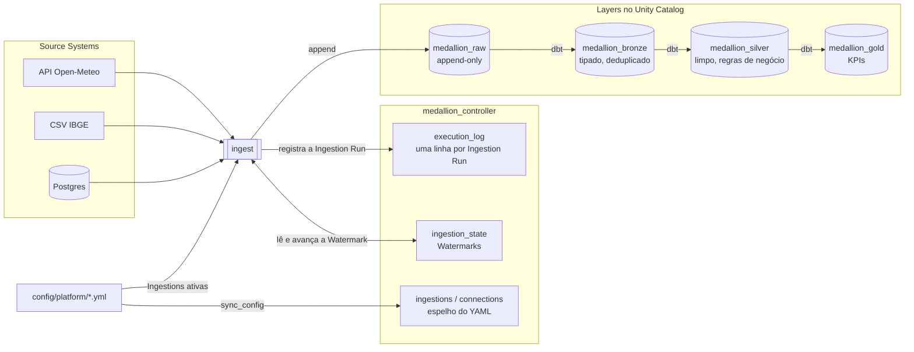
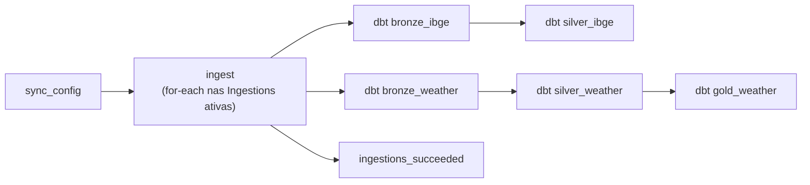

# Medallion Platform

Plataforma de dados **orientada a metadados** no Databricks. Para trazer um dado novo, você
**declara** a fonte num arquivo YAML: a plataforma cria a estrutura no Unity Catalog, ingere o dado
como chegou numa camada **raw** imutável e o refina com dbt através de **bronze → silver → gold**.
Nenhum código novo é necessário para uma fonte de API, CSV ou banco relacional.

Hoje ela roda todo dia às 06:00 (America/Sao_Paulo) com três Source Systems: clima horário de São
Paulo (API Open-Meteo), municípios do IBGE (CSV) e pedidos de um Postgres (JDBC, inativo; veja
[Conexões](docs/connections.md)).

## Destaques técnicos

- **Config como fonte da verdade.** Catálogos, schemas, volumes e permissões do Unity Catalog são
  declarados em [`catalog_structure.yml`](config/platform/catalog_structure.yml) e reconciliados a
  cada deploy, inclusive revogando permissões dadas à mão ([ADR 0004](docs/adr/0004-catalog-structure-reconciles-grants.md)).
- **Ingestão incremental com Watermark.** Cada Ingestion lembra até onde já leu (maior valor da
  coluna incremental ou impressão digital do arquivo) e a próxima Run lê só o que é novo. APIs com
  dado atrasado usam uma janela com `lag_days`.
- **Raw imutável.** Toda carga é apenas acrescentada e carimbada com a Run que a produziu;
  reprocessar gera duplicatas na raw de propósito, e a bronze deduplica com MERGE incremental. Assim
  qualquer camada pode ser reconstruída a partir da raw ([ADR 0002](docs/adr/0002-raw-is-append-only.md)).
- **Config e estado separados.** O espelho do YAML é sobrescrito a cada sync; o estado aprendido
  (Watermark, última Run) vive numa tabela à parte, escrita só pelo runtime
  ([ADR 0003](docs/adr/0003-ingestion-config-and-state-are-separate.md)).
- **Arquitetura hexagonal com limites verificados.** Regras de negócio ficam em `controller` e
  `ingestion`, que não conhecem Spark; só `medallion.databricks` importa pyspark, databricks-sdk ou
  dbutils. O CI falha se alguém quebrar essa regra ([ADR 0005](docs/adr/0005-controller-and-medallion-are-separate-modules.md)).
- **Testes sem cluster.** 129 testes rodam em ~2 s, sem Spark nem JVM, usando fakes das portas em
  [`tests/fakes/`](tests/fakes/).
- **CI/CD de ponta a ponta no GitHub Actions.** Todo PR é validado em duas frentes: código, config e
  dbt sem credenciais, e o diff que seria aplicado no workspace real. Só o merge publica, como
  Databricks Asset Bundle versionado junto com o código ([ADR 0001](docs/adr/0001-databricks-asset-bundles.md)).
  Detalhes em [CI/CD com GitHub Actions](#cicd-com-github-actions).

## Arquitetura



A plataforma tem duas partes ([ADR 0005](docs/adr/0005-controller-and-medallion-are-separate-modules.md)):

- **Controller** declara, configura e registra: config, Catalog Structure, Ingestion State e o log
  de execução, no catálogo `medallion_controller`. Não guarda dado de negócio.
- **Medallion** move e refina o dado: as Ingestions para a raw e, depois, os projetos dbt.

O vocabulário (Source System, Ingestion, Watermark, Run, Layer…) está definido em
[`CONTEXT.md`](CONTEXT.md).

## Como roda

Um único job, definido em [`databricks.yml`](databricks.yml) e publicado como Asset Bundle com o
pacote `medallion`, roda todo dia às 06:00:



<!-- Prints do workspace (adicionar em docs/img/):


-->

O merge na `main` aplica a Catalog Structure, garante os secret scopes, envia os arquivos de origem
para o Volume e publica o bundle. Ele **nunca** dispara uma Run.

## CI/CD com GitHub Actions

Nada chega ao workspace sem passar pelo GitHub Actions. Um pull request só mostra o que **mudaria**; o
merge na `main` é o único caminho que **muda** o workspace, e mesmo ele não executa dados.


### No pull request: [`ci.yml`](.github/workflows/ci.yml)

Dois jobs em paralelo, separados pelo que precisam acessar:

**`validate`**: roda sem nenhuma credencial, então qualquer PR passa por ele.

| Etapa | O que garante |
|---|---|
| `ruff check` | estilo e os limites de import do [ADR 0005](docs/adr/0005-controller-and-medallion-are-separate-modules.md) (regra `TID251`): só `medallion.databricks` pode importar Spark ou o SDK |
| `pytest` | os 129 testes dos casos de uso, com fakes no lugar de Spark e Databricks |
| build do pacote | o `medallion` empacota de verdade |
| `medallion-validate-config` | o YAML da plataforma é válido contra os modelos Pydantic (tipos, referências entre Ingestions e Connections) |
| `dbt parse` em cada projeto | SQL e Jinja dos modelos dbt sem erro, usando um profile de mentira, sem conectar no warehouse |

**`bundle`**: roda no ambiente `prod` do GitHub, com as credenciais do workspace.

| Etapa | O que garante |
|---|---|
| `databricks bundle validate` | a definição do job e do pacote é aceita pelo Databricks |
| dry-run da Catalog Structure | imprime no log do PR **o diff** que o merge vai aplicar no Unity Catalog (catálogos, schemas, permissões a conceder ou revogar), sem mudar nada |

### No merge: [`deploy.yml`](.github/workflows/deploy.yml)

Um job no ambiente `prod`, em ordem:

1. **Confere os secrets:** falha cedo, com mensagem clara, se `DATABRICKS_HOST` ou `DATABRICKS_TOKEN` não estiverem configurados.
2. **Aplica a Catalog Structure:** cria o que falta e reconcilia as permissões, inclusive revogando; nunca apaga catálogos, schemas ou volumes ([ADR 0004](docs/adr/0004-catalog-structure-reconciles-grants.md)).
3. **Garante os secret scopes** das Connections declaradas. Os valores são colocados à mão e nunca passam pelo CI ([Conexões](docs/connections.md)).
4. **Envia os CSVs de origem** para o Volume `medallion_raw.sources.files`.
5. **`databricks bundle deploy`:** publica o pacote e o job agendado ([ADR 0001](docs/adr/0001-databricks-asset-bundles.md)). Cada deploy gera uma versão única do pacote (`dynamic_version`), para o compute serverless nunca reaproveitar um pacote antigo do cache.

O deploy **não dispara uma Run**: publicar código e processar dado são eventos separados. A próxima
Run agendada já usa a versão nova.

### Segurança da pipeline

- **Credenciais só no ambiente `prod`** do GitHub, e só nos jobs que falam com o workspace.
- **Actions de terceiros fixadas por commit**, não por branch: o deploy roda com o token do
  workspace no ambiente, então uma mudança na action só entra depois de revisada. O
  [Dependabot](.github/dependabot.yml) abre um PR semanal quando sai uma versão nova.
- **PRs de fork não acessam o workspace.** O GitHub não entrega secrets a eles, e o job `bundle`
  roda só para branches deste repositório; o `validate`, que não precisa de credenciais, roda para
  todos.

## Adicionando uma fonte

1. Declare o Source System em [`config/platform/catalog_structure.yml`](config/platform/catalog_structure.yml)
   (ele vira um schema em cada Layer).
2. Adicione as Ingestions em `config/platform/ingestions/<source_system>.yml`; cada uma cai em
   `medallion_raw.<source_system>.<raw_table>`.
3. Para bancos de dados, declare uma Connection e coloque a senha à mão: veja
   [`docs/connections.md`](docs/connections.md).
4. Crie os projetos dbt `dbt/bronze_<system>`, `dbt/silver_<system>`… e as tarefas deles em
   `databricks.yml`.

## Desenvolvimento

```bash
make install    # ambiente de desenvolvimento
make lint       # ruff, incluindo os limites de import
make test       # pytest, sem cluster Spark
make validate   # config + definição do bundle
make plan       # diff da Catalog Structure contra o workspace (dry-run)
make deploy     # apply + bundle deploy a partir da sua máquina (o CI faz isso no merge)
```

`validate`, `plan` e `deploy` leem `DATABRICKS_HOST` / `DATABRICKS_TOKEN` do `.env`
(veja [`.env.example`](.env.example)).
